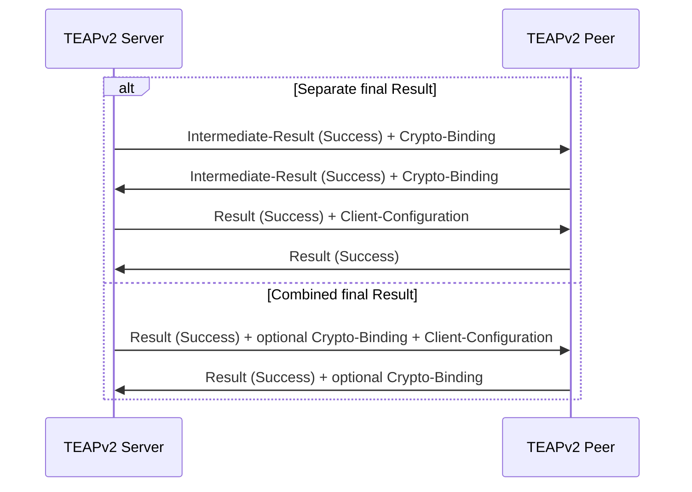

# TEAPv2 Client-Configuration Extension

## Summary

This document proposes a protected TEAPv2 Client-Configuration TLV that
delivers an RFC 7951 JSON encoding of the RFC 9243 `option-set` list from the
TEAP server to the client. The TLV starts with the list's array value; it does
not include `dhcpv6-server`, `option-sets`, or an `option-set` member. It is a
schema-bound fragment, not a complete RFC 7951 datastore document.

The initial array demonstrates a standard option from
`example-dhcpv6-server-options` and two vendor options from
`example-teapv2-dhcpv6-vendor-options`:

```json
[
  {
    "option-set-id": "teap-client",
    "example-dhcpv6-server-options:dns-recursive-name-server-option": {
      "server-address": ["2001:db8::53"]
    },
    "example-teapv2-dhcpv6-vendor-options:vendor-cisco-80211-ssid":
      "Example-Network",
    "example-teapv2-dhcpv6-vendor-options:vendor-cisco-tls-proxy":
      "https://proxy.example.net:8443"
  }
]
```

- `vendor-cisco-80211-ssid` identifies an SSID for a subsequent 802.11
  connection.
- `vendor-cisco-tls-proxy` identifies a proxy recommendation that the client
  records and reports without changing its HTTP subsystem. The support
  program can write the URL to a configured file.

The client stages the configuration while processing the protected TEAPv2
exchange and exposes it only after authentication, crypto-binding, and the
protected final Result exchange have succeeded. A separate support program
applies recognized local policy.

## Wire Format

Define a symbolic TLV type:

```c
TEAPV2_TLV_CLIENT_CONFIGURATION = TBD
```

The value of the TLV is exactly one JSON array:

```text
0                   1                   2                   3
0 1 2 3 4 5 6 7 8 9 0 1 2 3 4 5 6 7 8 9 0 1 2 3 4 5 6 7 8 9 0 1
+-+-+-+-+-+-+-+-+-+-+-+-+-+-+-+-+-+-+-+-+-+-+-+-+-+-+-+-+-+-+-+-+
|M|R| Client-Configuration TBD |        Length                 |
+-+-+-+-+-+-+-+-+-+-+-+-+-+-+-+-+-+-+-+-+-+-+-+-+-+-+-+-+-+-+-+-+
|                 UTF-8 JSON array ...                         |
+-+-+-+-+-+-+-+-+-+-+-+-+-+-+-+-+-+-+-+-+-+-+-+-+-+-+-+-+-+-+-+-+
```

For standards work, a TEAP TLV allocation should be requested rather than
permanently assigning the next apparent value, 19. A prototype can instead
encapsulate the JSON in the existing Vendor-Specific TLV, type 7, using an
enterprise ID and vendor subtype.

The following encoding rules apply:

- The TLV value MUST be valid UTF-8 JSON with an array at its root.
- The array MUST contain at least one `option-set` list entry. Each entry is
  a JSON object and MUST contain a unique string `option-set-id`.
- The array is the value of the RFC 9243 `option-set` list. No ancestor,
  sibling, or other YANG node is permitted. In particular,
  `pd-exclude-option`, which the standard-options module augments under
  `prefix-pool`, is not permitted.
- Member names and values follow RFC 7951 relative to the
  `ietf-dhcpv6-server` `option-set` list. Nodes from that module use simple
  names. Augmented nodes use `module-name:identifier`; descendants in the
  same module use simple names.
- Array order has no meaning for the `option-set` list, which is
  `ordered-by system`. Arrays representing nodes declared `ordered-by user`
  preserve their supplied order.
- The maximum value size is 4096 bytes, despite the 16-bit TLV length field.
- A byte-order mark and a trailing NUL are not permitted.
- Duplicate member names are invalid.
- Apart from `option-set-id`, recognized option members are optional.
- Unknown namespace-qualified members are ignored by the TEAP implementation
  and retained when the complete array is passed to an external consumer.
- At most one Client-Configuration TLV is allowed in a TEAPv2 session.
- The server sends the TLV only with the protected final Result TLV, after
  authentication and authorization decisions have completed.

## TLV Insertion and Processing Flow

The configuration belongs in the final protected Phase 2 message. If the
server uses a combined final result, it is appended after the Result and any
required Crypto-Binding TLV. If `eap_teapv2_separate_result=1`, it is omitted
from the Intermediate-Result/Crypto-Binding message and appended to the
subsequent protected final Result message.



The main combined-result insertion point is
`eap_teapv2_result_maybe_crypto_binding()` in
`src/eap_server/eap_server_teapv2.c`. The `SUCCESS_SEND_RESULT` and
`PKCS7_READY` cases in `eap_teapv2_buildReq()` must call the same append helper
so that separate-result and certificate-enrollment completion paths do not
omit the configuration.

## Option-Set JSON Semantics

Each array element represents one RFC 9243 `option-set` list entry.
`option-set-id` is its YANG list key and has no protocol meaning outside the
array. Duplicate keys are invalid.

Standard members are defined by
`example-dhcpv6-server-options@2026-08-22.yang`. Vendor members are defined by
`example-teapv2-dhcpv6-vendor-options@2026-08-24.yang`. Their JSON values and
constraints follow those YANG modules and RFC 7951.

### `example-teapv2-dhcpv6-vendor-options:vendor-cisco-80211-ssid`

- The value is a JSON string.
- Its UTF-8 encoding must be between 1 and 32 octets.
- An embedded NUL is invalid.
- It identifies an SSID for a subsequent 802.11 connection.
- `wpa_supplicant` stores and reports this member without interpreting it.
- After TEAP and cleartext EAP-Success complete, the support program
  duplicates the network profile used for the authenticated connection and
  replaces only the duplicate's SSID. It does not modify or remove the source
  profile.
- Every other configurable field is copied unchanged, including key
  management, EAP method, identities, credentials, certificates, trust
  anchors, cipher policy, priority, and scan policy. A new internal profile
  identifier is bookkeeping, not a configuration change.
- Runtime connection state, cached keys, counters, and temporary protocol
  state are not profile configuration and are not copied.
- The support program keeps the new profile disabled until copying and SSID
  replacement complete. On failure, it removes the incomplete profile.
- The operation does not disconnect the active network. Network selection may
  consider the duplicate only after the current EAP exchange completes.
- If the new SSID equals the source SSID, the support program makes no
  configuration change. It records completed source/SSID pairs and reuses the
  corresponding destination while it remains available.
- If the client cannot identify the source network profile, it rejects this
  option.
- This form cannot represent arbitrary non-UTF-8 SSIDs. A future YANG leaf
  can use the `binary` type, encoded as base64 by RFC 7951.

### `example-teapv2-dhcpv6-vendor-options:vendor-cisco-tls-proxy`

- The value is a JSON string containing an absolute proxy URL.
- The initial version permits `http://` and `https://` schemes.
- URL fragments and userinfo are invalid.
- The maximum encoded length is 2048 bytes.
- The client does not configure an HTTP subsystem from this member.
- After successful TEAP completion, the value is retained in the
  client-configuration state table and exposed through the control interface.
- If the support program has a TLS proxy output file configured, it writes the
  URL there as described below.

Unknown future namespace-qualified option members do not invalidate an
otherwise valid array.

## Required and Advisory Configuration

The server uses the TLV M bit to express policy:

- With M=0, the configuration is advisory. An older peer ignores it. A peer
  that recognizes the TLV can ignore invalid or unsupported option members
  while reporting a local diagnostic without failing authentication.
- With M=1, the configuration is required. An older peer NAKs it. A supporting
  peer returns a protected Result failure and an appropriate Error TLV if the
  array cannot be accepted.

A separate acknowledgement TLV is not required initially. The peer's
protected Result response acknowledges successful parsing when the
configuration accompanies the final Result. A future extension can add a
per-member status TLV if the server needs to distinguish unsupported,
invalid, and application failures.

The acknowledgement covers validation and storage by `wpa_supplicant`, not
later action by the support program. A support-program failure cannot
retroactively change the completed EAP result.

## Server Implementation

Add hostapd configuration such as:

```text
eap_teapv2_client_config=/etc/hostapd/teapv2-client.json
eap_teapv2_client_config_required=0
```

Using a file avoids configuration-line quoting problems and allows the array
to grow. Hostapd should parse and validate the file at startup with the
existing JSON parser rather than treating it as opaque data.

The setting flows through:

- `struct hostapd_bss_config` in `src/ap/ap_config.h`
- the hostapd parser in `hostapd/config_file.c`
- `authsrv_eap_config()` in `src/ap/authsrv.c`
- `struct eap_config` in `src/eap_server/eap.h`

The server keeps the validated JSON in `struct eap_config`. A helper appends
it exactly once when building a protected final success message. The buffer
is freed with the server configuration.

A static file is suitable for the first implementation. Identity-specific or
AAA-provided option-set JSON can later use a server callback without changing
the wire format.

## Client Implementation

Extend `struct eap_teapv2_tlv_parse` with fields similar to:

```c
u8 *client_config;
size_t client_config_len;
bool client_config_mandatory;
```

The peer performs the following processing:

1. Reject duplicate TLVs and values larger than the configured limit.
2. Parse the value with `json_parse()`.
3. Validate each entry against the implemented `option-set` schema and copy
   the raw array into TEAP session state.
4. Complete Crypto-Binding and protected Result validation.
5. Return the protected Result response.
6. Install the staged array in the client-configuration state table only
   after successful TEAP and cleartext EAP-Success completion.
7. Erase staged configuration on failure, deinitialization, or unsuccessful
   reauthentication.

The last two steps prevent configuration consumers from acting before the
peer has transmitted its protected Result response.

A typed internal callback carries the accepted array through the EAP and
EAPOL layers to `wpa_supplicant`, adjacent to `notify_status`:

```c
void (*client_config)(void *ctx, const u8 *json, size_t len,
                      int mandatory, unsigned int option_sets);
```

The receiver copies the value into the state table. EAP does not emit the
external event or retain ownership of the array.

## State Table and Control Interface

`wpa_supplicant` maintains an in-memory client-configuration table per
interface. Each row contains:

- a local row index;
- `option-set-id`;
- whether the TLV was mandatory;
- the source network identifier;
- the validated JSON object for that option-set.

Installing a new successful result atomically replaces the previous table and
increments a generation counter. Failed authentication or rejected
configuration does not replace the last successful table. The table is
cleared when the interface is removed or `wpa_supplicant` terminates; it is
not written to the configuration file.

After replacement, `wpa_supplicant` emits exactly one event:

```text
CTRL-EVENT-TEAPV2-CLIENT-CONFIG generation=<number> option_sets=<count> network_id=<id>
```

The event contains no option values. A control-interface monitor uses the
generation number to detect replacement and then queries the table. This is
the only asynchronous outward notification; the query operation is read-only.

Add this control-interface command:

```text
TEAPV2_CLIENT_CONFIG
```

The command returns the complete current `option-set` JSON array. An optional
generation argument requires an exact match and returns `FAIL-STALE` if the
table has since been replaced. The command returns `FAIL-NO-RESULT` before any
successful result exists. Add the corresponding
`wpa_cli teapv2_client_config [generation]` command. Output follows the same
4096-byte limit as the received TLV.

Define the event token in `src/common/wpa_ctrl.h`. Store the table and
generation counter in `struct wpa_supplicant`, handle the request in
`wpa_supplicant/ctrl_iface.c`, and register the command in
`wpa_supplicant/wpa_cli.c`.

`wpa_supplicant` does not contain option-specific behavior for either vendor
member. It validates, stores, and reports the complete option-set array.

## Client-Configuration Support Program

Add `teapv2_config_handler`, a companion program that attaches to the
`wpa_supplicant` control interface and listens for
`CTRL-EVENT-TEAPV2-CLIENT-CONFIG`. On receipt, it:

1. Reads the event's generation and source `network_id`.
2. Runs `TEAPV2_CLIENT_CONFIG <generation>` and parses the RFC 7951
   option-set array. On `FAIL-STALE`, it waits for the newer event.
3. Locates
   `example-teapv2-dhcpv6-vendor-options:vendor-cisco-80211-ssid`.
4. Revalidates the SSID length and encoding.
5. Uses existing control-interface commands to create a new network and copy
   the source profile with only `ssid` replaced.
6. Locates
   `example-teapv2-dhcpv6-vendor-options:vendor-cisco-tls-proxy` and updates
   the configured proxy output file.

The program independently processes the SSID and TLS proxy members. It ignores
all other members.

Build the program from `wpa_supplicant/teapv2_config_handler.c` using the
existing `wpa_ctrl` client library. It runs independently of the
`wpa_supplicant` process.

The support program uses the existing commands exposed by `wpa_cli`:

1. `GET_NETWORK <source-id> ssid` confirms the source SSID. If it equals the
   requested SSID, processing stops successfully.
2. `ADD_NETWORK` creates the disabled destination and returns its identifier.
3. For every network field supported by the build except `ssid` and
   `disabled`, `GET_NETWORK <source-id> <field>` determines whether the field
   is set. `DUP_NETWORK <source-id> <destination-id> <field>` copies each set
   field inside `wpa_supplicant`, including credentials that `GET_NETWORK`
   deliberately reports only as `*`.
4. `SET_NETWORK <destination-id> ssid <hex-value>` sets the new SSID using
   hexadecimal UTF-8 octets.
5. `DUP_NETWORK <source-id> <destination-id> disabled` copies the source's
   enabled state last, after the destination is complete.
6. On any failure after `ADD_NETWORK`, `REMOVE_NETWORK <destination-id>`
   removes the incomplete destination.

The program uses the `wpa_ctrl` client library to issue these existing
commands; it does not spawn `wpa_cli`. Its field inventory tracks the
`network_fields` list used by `wpa_cli`. Move that inventory to a shared
header used by both programs so the lists cannot drift. No new
control-interface command is required.

The program does not select the new profile or call `SAVE_CONFIG` unless
separately configured to do so. It suppresses duplicate handling of the same
event generation and retains an in-memory mapping from source network and
target SSID to the created destination.

### TLS Proxy Output File

Add this optional `teapv2_config_handler` configuration setting:

```text
tls_proxy_file=/run/teapv2/tls-proxy
```

If unset, the program does not write a proxy file. For each new generation,
the program collects the TLS proxy leaves from all option sets. No value is
accepted if distinct URLs occur; repeated identical URLs are treated as one.

For one accepted URL, the program writes its UTF-8 bytes followed by a newline
to a temporary file in the destination directory, sets mode `0600`, calls
`fsync()`, and renames it over the configured path. It never exposes a partial
file. The destination directory must be trusted and must not be writable by
unprivileged users.

If the current generation contains no TLS proxy leaf, the program removes the
previous output file. A validation or write failure leaves the previous file
unchanged and reports a diagnostic without including the URL. The program
also queries the current state and synchronizes the proxy output when it
starts, so proxy-file handling does not depend on observing the original
event.

## Security Requirements

The client accepts configuration only when:

- the TEAP tunnel authenticated the intended server certificate;
- protected success and required Crypto-Binding validation succeeded; and
- the active authorization result is successful.

Provisioning must be refused for a TEAP profile that deliberately disables
server certificate validation. Otherwise, a rogue TEAP server could select a
The proxy URL must not contain credentials and must not be written to logs or
included in the event. It appears only in the protected query response and,
when configured, the mode-`0600` output file. Receiving the option never
changes HTTPS behavior.

Duplicating a profile intentionally copies its authentication configuration
to the new SSID. The support program acts only on the post-success event and
must use the event's source network identifier. The existing control commands
copy configuration fields, not runtime key material.

## Tests

Tests should cover:

- valid delivery in combined-result and separate-result flows;
- delivery after client-certificate authentication and PKCS#7 enrollment;
- optional unknown namespace-qualified option members;
- an unknown mandatory Client-Configuration TLV;
- duplicate TLVs and duplicate JSON member names;
- malformed JSON, a non-array root, and oversized arrays;
- empty arrays, missing or duplicate `option-set-id` values, and nodes outside
  `option-set`;
- empty SSIDs, embedded NULs, and SSIDs over 32 octets;
- field-for-field duplication of the source profile with only the SSID
  changed;
- preservation of the source profile and absence of partial profiles after
  failure;
- no duplicate profile for a repeated generation or unchanged SSID;
- rejection when no source network profile can be identified;
- no network switch before cleartext EAP-Success;
- absence of vendor-option names and SSID-specific handling in
  `wpa_supplicant`;
- support-program event handling, generation selection, and JSON parsing;
- support-program behavior when the SSID member is absent or invalid;
- source inspection with `GET_NETWORK` and field copying with `DUP_NETWORK`;
- destination creation, final SSID replacement, and rollback with existing
  control-interface commands;
- invalid proxy schemes, URL userinfo, and oversized proxy URLs;
- an unset and configured `tls_proxy_file`;
- atomic proxy-file replacement, mode `0600`, and trailing newline;
- removal when the current generation omits the proxy;
- identical and conflicting proxy values across multiple option sets;
- write failure retaining the previous file without logging the URL;
- startup synchronization from an existing state table;
- state-table replacement only after successful EAP completion;
- retention of the previous table after a failed exchange;
- one value-free event per replacement with the correct generation and count;
- `wpa_cli teapv2_client_config` before and after a successful result;
- table clearing on interface removal and process termination;
- absence of HTTP subsystem calls;
- fragmented delivery;
- authentication failure before the final Result;
- invalid or missing Crypto-Binding; and
- clearing staged configuration on failure and reauthentication reset.
